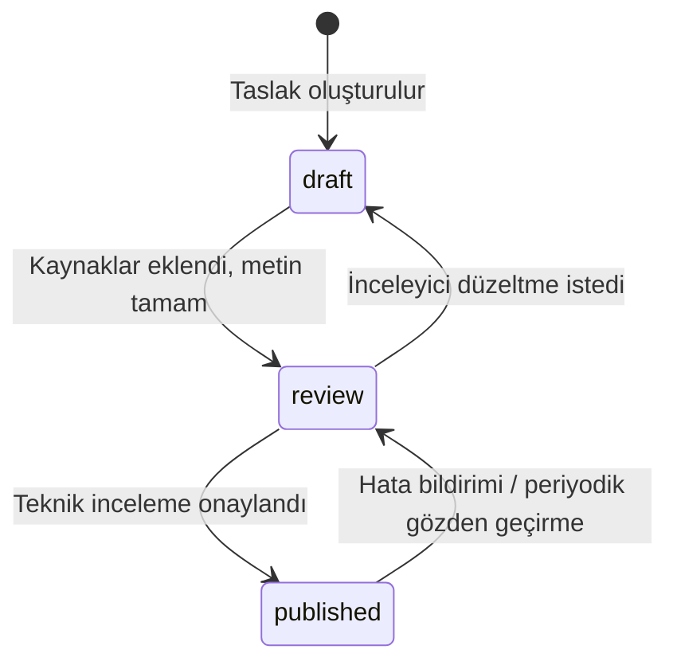

# İçerik iş akışı

Bu belge; makale, sözlük terimi ve hesaplayıcı açıklamalarının nasıl hazırlanıp incelendiğini ve
yayımlandığını anlatır. v1'de ayrı bir yönetim paneli yoktur: **yönetim alanı GitHub'dır.** İçerikler
Git deposunda tutulur, değişiklikler çekme isteği (pull request) ile önerilir, otomatik kontrollerden
ve teknik incelemeden geçtikten sonra yayımlanır.

> Neden yönetim paneli yok? Ürün planına göre `/yonetim` alanı eklenirse kimlik doğrulama ve
> yetkilendirme gerektirir. GitHub bu ihtiyacı ücretsiz karşılar: hesap güvenliği (2FA), yetki
> seviyeleri, zorunlu inceleme, değişiklik geçmişi ve geri alma. İleride teknik olmayan editörler için
> Git tabanlı bir CMS (ör. Decap CMS) aynı dosyaları düzenleyecek şekilde eklenebilir.

## Durumlar



| Durum | Anlamı | Nerede görünür? |
|---|---|---|
| `draft` | Yazım sürüyor | Yalnızca geliştirme ve önizleme ortamı |
| `review` | Teknik inceleme bekliyor | Yalnızca geliştirme ve önizleme ortamı |
| `published` | İncelendi, yayında | Üretim sitesi, arama, site haritası |

## Roller

| Rol | Görev |
|---|---|
| Yazar | Taslağı yazar, kaynakları ekler, `npm run content:check` çalıştırır, çekme isteği açar |
| Teknik inceleyici | Konusunda yetkin kişi (`kisiler.yaml`'da `kind: kisi`, `canReview: true`). Kaynakları ve teknik doğruluğu kontrol eder; onaylarsa kendini `reviewers` alanına ekler |
| Editör / depo sahibi | Çekme isteğini birleştirir; birleştirme sonrası site otomatik yayımlanır |

**Kural:** Yapay zekâ desteğiyle hazırlanan (`aiAssisted: true`) içerik, gerçek bir kişi tarafından
incelenmeden yayımlanamaz. Doğrulama betiği bunu otomatik olarak engeller.

## Adım adım: yeni makale

PowerShell, macOS ve Linux'ta komutlar aynıdır:

```powershell
git checkout -b icerik/bant-konveyor-bakimi
npm run new -- makale "Bant konveyör bakımında temel kontroller"
# content/makaleler/bant-konveyor-bakiminda-temel-kontroller.md oluşur (status: draft)
npm run dev
# http://localhost:3000/bilgi/bant-konveyor-bakiminda-temel-kontroller adresinde önizleyin
npm run content:check
git add content
git commit -m "İçerik: bant konveyör bakımı taslağı"
git push -u origin icerik/bant-konveyor-bakimi
```

Ardından GitHub'da çekme isteği açın. Durumu `review` yapın ve inceleyiciyi atayın.

## Yayımlama kontrol listesi (inceleyici için)

Çekme isteği şablonu (`.github/pull_request_template.md`) bu listeyi içerir:

- [ ] Her teknik iddia bir kaynağa bağlı (`[@kaynak-id]`) ve kaynak gerçekten bu iddiayı destekliyor.
- [ ] Kaynaklar öncelik sırasına uygun (resmî kurum → akademik/teknik → mevzuat/standart → sektör).
- [ ] Formüller, birimler ve sayısal örnekler elle kontrol edildi.
- [ ] Mevzuat içeriğinde yürürlük tarihi, son değişiklik ve resmî metin bağlantısı güncel.
- [ ] Standart metinleri kopyalanmadı; yalnızca künye ve madde numarası verildi.
- [ ] Güvenlikle ilgili konularda (havalandırma, tahkimat, patlatma, İSG) uyarı notu var.
- [ ] `status: published`, `publishedAt`, `reviewedAt` ve `reviewers` alanları dolduruldu.

## Ön bilgi alanları (makale)

| Alan | Zorunlu | Açıklama |
|---|---|---|
| `title` | Evet | 5–110 karakter. Arama sonucunda kesilmemesi için ≤ 60 önerilir (`seoTitle` ile kısaltılabilir) |
| `summary` | Evet | 40–280 karakter; kartlarda ve meta açıklamada kullanılır. 160'ı aşarsa `seoDescription` ekleyin |
| `category` | Evet | `konular.yaml`'daki slug |
| `tags`, `keywords` | Hayır | Etiketler ve aramada eşleşmesi istenen eş anlamlılar |
| `relatedCalculators`, `relatedTerms`, `relatedArticles` | Hayır | İçerikler arası bağlantılar |
| `status` | Evet | `draft`, `review`, `published` |
| `authors` | Evet | `kisiler.yaml`'daki kimlikler |
| `reviewers` | Yayında evet | `canReview: true` olan kişiler |
| `publishedAt`, `reviewedAt` | Yayında evet | YYYY-AA-GG |
| `updatedAt` | Hayır | Son içerik güncellemesi |
| `sources` | Yayında evet | `[{ id, note, locator }]` — `note`: kaynağın desteklediği iddia |
| `corrections` | Hayır | `[{ date, note }]` — düzeltme geçmişi; sayfada görünür |
| `legal` | Mevzuat konusunda evet | Düzenleme adı, Resmî Gazete bilgisi, yürürlük, son değişiklik, resmî bağlantı, son kontrol tarihi |
| `aiAssisted` | Hayır | Taslak yapay zekâ desteğiyle hazırlandıysa `true` |

Sözlük terimleri ve hesaplayıcı açıklamaları benzer alanlar kullanır; tam liste `src/lib/content/schemas.ts`
dosyasındadır. Şablonlar: `content/_sablonlar/`.

## Kaynak ekleme

`content/kaynaklar.yaml` dosyasına yeni kayıt ekleyin:

```yaml
- id: wills-finch-2016          # küçük harf, rakam ve tire
  type: kitap                   # resmi-kurum | mevzuat | akademik | kitap | standart | kilavuz | sektor
  title: "Wills' Mineral Processing Technology"
  authors: Wills, Barry A.; Finch, James A.
  publisher: Butterworth-Heinemann (Elsevier)
  published: 2016               # belge tarihi
  edition: 8. baskı
  identifier: ISBN 978-0-08-097053-0
  language: en
```

URL'si olan kaynaklarda `url` ve `accessedAt` (erişim tarihi) birlikte verilir. Mevzuatta
`identifier` alanına Resmî Gazete tarihi ve sayısı yazılır.

Metinde atıf: `... iki ürün formülü kullanılır [@wills-finch-2016].` Birden fazla kaynak:
`[@kaynak-1; @kaynak-2]`. Atıflar, kaynak listesindeki sıraya göre numaralandırılır.

## Teknik inceleyici ekleme

`content/kisiler.yaml` dosyasına gerçek bilgilerle ekleyin:

```yaml
- id: ayse-yilmaz
  name: Ayşe Yılmaz
  kind: kisi
  title: Maden Mühendisi
  affiliation: Örnek Madencilik A.Ş.
  bio: Açık ocak planlama, 12 yıl.
  canReview: true
```

## Otomatik kontroller

`npm run content:check` (CI'da her çekme isteğinde çalışır) şunları denetler:

**Hata (birleştirmeyi engeller):** şemaya uymayan ön bilgi veya YAML; tanımsız konu, etiket, kişi veya
kaynak; inceleme yetkisi olmayan inceleyici; metindeki atfın kaynak listesinde olmaması; kırık site içi
bağlantı; gelecek tarih; yayımlanan içerikte eksik inceleyici/inceleme tarihi/yayın tarihi/kaynak;
gerçek kişi incelemesi olmadan yayımlanan yapay zekâ destekli içerik; mevzuat makalesinde eksik `legal`;
URL'si olup erişim tarihi olmayan kaynak; motoru olmayan hesaplayıcı sayfası; rehberde bulunmayan öğe;
eksik güven sayfası.

**Uyarı:** metinde atıf yapılmayan kaynak; yayımlanmamış içeriğe bağlantı; 12 aydan eski teknik inceleme;
6 aydan uzun süredir kontrol edilmemiş mevzuat; uzun başlık veya açıklama; kullanılmayan kaynak;
yinelenen terim.

## Periyodik gözden geçirme

- Yayımlanan içerikler en az **yılda bir** gözden geçirilir (betik 12 ayı aşanları uyarır).
- Mevzuat içerikleri en az **altı ayda bir** resmî metinle karşılaştırılır.
- Düzeltmeler `corrections` alanına tarihleriyle eklenir; önemli bilgiler sessizce değiştirilmez
  (bkz. `content/sayfalar/duzeltme-politikasi.md`).

## GitHub'da önerilen ayarlar

**Settings → Branches → Branch protection rule (`main`):**

- Require a pull request before merging (en az 1 onay)
- Require status checks to pass: **CI / kalite**
- Do not allow bypassing the above settings

Böylece hiçbir içerik incelenmeden ve kontrollerden geçmeden yayına çıkamaz.
