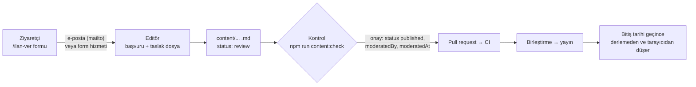

# Sanal Fuar, İş İlanları ve Market

Bu belge sektör ağı bölümlerinin nasıl çalıştığını, editörün bir başvuruyu nasıl yayımladığını ve
bölümleri yayına almadan önce yapılması gerekenleri anlatır.

| Bölüm | Adres | İçerik dosyaları | Yayın süresi |
|---|---|---|---|
| Sanal Fuar (firma standları) | `/fuar`, `/fuar/salonlar/<salon>`, `/fuar/<firma>` | `content/fuar/*.md`, salonlar `content/fuar-salonlari.yaml` | En fazla 365 gün |
| İş ilanları (işçi arayanlar) | `/is-ilanlari`, `/is-ilanlari/<ilan>` | `content/is-ilanlari/*.md`, meslekler `content/meslekler.yaml` | En fazla 60 gün |
| Aday profilleri (iş arayanlar) | `/is-arayanlar`, `/is-arayanlar/<başvuru-no>` | `content/is-arayanlar/*.md` | En fazla 60 gün |
| Market | `/market`, `/market/kategori/<kategori>`, `/market/<ilan>` | `content/market/*.md`, kategoriler `content/market-kategorileri.yaml` | En fazla 90 gün |
| Başvuru formları | `/ilan-ver`, `/ilan-ver/<tür>`, `/iletisim-talebi` | — | — |
| Kurallar ve KVKK | `/ilan-kurallari`, `/kvkk` | `content/sayfalar/ilan-kurallari.md`, `content/sayfalar/kvkk.md` | — |

## Temel kararlar

- **Üyelik, veritabanı ve ödeme yok.** Site statik kalır; ücretsiz statik barındırmada çalışır.
- **Her başvuru editör onayından geçer.** Ziyaretçi formu doldurur; başvuru editöre e-postayla (veya
  isteğe bağlı bir form hizmetiyle) ulaşır; editör içerik dosyasını oluşturup yayımlar. Bu, ürün
  planındaki “içerik ekleme, düzenleme ve yayımlama iş akışı”nın (GitHub PR + CI) aynısıdır.
- **Süresi dolan ilan kendiliğinden kalkar.** Üretim derlemesi süresi dolan ilanı almaz; ziyaretçinin
  tarayıcısı da bitiş tarihini denetleyip ilanı listeden gizler. Günlük yeniden derleme iş akışı
  (aşağıda) siteyi her gece yeniler.
- **Aday profillerinde kişisel veri yok.** Ad ve iletişim bilgisi içerik dosyasına hiç yazılmaz;
  işverenlerin talepleri editör aracılığıyla adaya iletilir. Aday sayfaları `noindex`'tir, site
  haritasına ve arama dizinine girmez.
- **Platform taraf değildir.** Alım-satıma, kiralamaya, ruhsat devrine ve işe alıma aracılık edilmez,
  ödeme alınmaz. Bu, ilan kurallarında ve her ilan sayfasındaki güvenlik notunda yazar.



## Yayına almadan önce (bir kez)

Formlar, **ilan kuralları** ve **KVKK aydınlatma metni** sayfaları `status: published` olana kadar
üretim sitesinde kapalıdır (“Başvurular yakında açılacak”). Önizleme ortamında her zaman açıktır.

1. **Başvuru adresi:** `src/config/site.ts` → `listingsEmail` değerini gerçek adresle değiştirin
   (şu an `ilan@maden360.example`). İletişim adresi (`contactEmail`) de ilan bildirimleri için kullanılır.
2. **KVKK aydınlatma metni:** `content/sayfalar/kvkk.md` dosyasındaki köşeli parantezli alanları
   doldurun (`[VERİ SORUMLUSUNUN ADI VEYA UNVANI]` vb.), en üstteki “Yayımlamadan önce” kutusunu silin
   ve metni bir hukuk danışmanına kontrol ettirin. Doğrulama, yer tutucu kalmışsa yayımlamayı engeller.
3. **İlan kuralları:** `content/sayfalar/ilan-kurallari.md` metnini gözden geçirin (yayın süreleri,
   kabul edilmeyen ilanlar, mevzuat atıfları).
4. Her iki sayfada `status: published` yapın → `npm run content:check` → PR → birleştirme.
5. **Depo görünürlüğü (önerilir):** Yayımlanan ilanlar ve satıcıların paylaşmayı seçtiği iletişim
   bilgileri Git geçmişinde kalıcıdır. Depo herkese açıksa bu geçmiş de herkese açıktır. GitHub'da
   deponun **gizli (private)** yapılması ücretsizdir ve Cloudflare Pages gizli depolardan da derleme
   yapabilir. Bkz. “Kişisel veriler ve kaldırma talepleri”.
6. **Günlük yeniden derleme (önerilir):** Aşağıdaki “Süresi dolan ilanlar” bölümüne bakın.
7. **Örnek içerikler:** `example: true` olan 18 örnek dosya (4 stand, 4 iş ilanı, 3 aday, 7 market
   ilanı) yalnızca önizlemede görünür ve yayımlanamaz. İlk gerçek ilanlar geldiğinde silebilirsiniz:

   ```powershell
   # PowerShell (Windows) — örnek dosyaları listele, kontrol et, sonra sil
   Get-ChildItem content\fuar, content\is-ilanlari, content\is-arayanlar, content\market -Filter *.md |
     Select-String -Pattern '^example: true' -List | Select-Object -ExpandProperty Path
   ```

## Başvuruların editöre ulaşması

| Yöntem | Ayar | Not |
|---|---|---|
| E-posta (varsayılan) | Yok (`listingsEmail`) | “Gönder” düğmesi ziyaretçinin e-posta programını başvuru metniyle açar; ziyaretçi e-postayı gönderir. Program açılmazsa sayfadaki “Metni kopyala” düğmesi kullanılır. Ek hizmet ve hesap gerekmez. |
| Form hizmeti | `NEXT_PUBLIC_FORM_ENDPOINT` (Web3Forms için ayrıca `NEXT_PUBLIC_FORM_ACCESS_KEY`) | Başvuru doğrudan gönderilir. Formspree (ücretsiz katman: aylık sınırlı gönderim) ve Web3Forms uyumludur. Hizmet yanıt vermezse form e-posta yöntemine düşer. |

Ortam değişkenleri derleme sırasında okunur; Cloudflare Pages'te **Settings → Environment variables**
bölümünden eklenir (bkz. `.env.example`). Yurt dışındaki form hizmetleri KVKK md. 9 (yurt dışına
aktarım) kapsamında değerlendirilmelidir; bu nedenle varsayılan yöntem e-postadır.

Her başvuruda bir **başvuru numarası** üretilir: `IS-` iş ilanı, `ADY-` aday profili, `MKT-` market
ilanı, `FRM-` fuar standı, `ILT-` iletişim talebi (ör. `MKT-20261016-K7QX`). Gelen e-postada:

1. okunur başvuru metni (yayımlanmayacak bölümler dahil: ilan sorumlusu, adayın iletişim bilgileri),
2. onaylanan beyanlar,
3. **editör için taslak içerik dosyası:** önerilen dosya yolu ve YAML ön bilgisiyle hazır Markdown.

Yayımlanmayacak bilgiler taslak dosyaya **yazılmaz**.

## Editör iş akışı

1. Taslağı önerilen yola kaydedin (ör. `content/market/parca-krom-cevheri.md`). Taslak yoksa veya
   elle başlamak isterseniz şablon kullanın:

   ```powershell
   npm run new -- firma "Örnek Sondaj Ltd. Şti."
   npm run new -- is-ilani "Maden Mühendisi (Planlama)"
   npm run new -- aday "Deneyimli ekskavatör operatörü"
   npm run new -- market "Satılık mobil kırıcı"
   ```

2. Başvuruyu kontrol edin (aşağıdaki liste). Gerekirse başvuru sahibine başvuru numarasıyla yazın.
3. Onaylarken ön bilgiye şunları ekleyin:

   ```yaml
   status: published
   postedAt: 2026-10-16      # yayın günü
   expiresAt: 2026-12-15     # en fazla: iş/aday 60, market 90, stand 365 gün
   moderatedBy: maden360-editorluk   # content/kisiler.yaml → canModerate: true
   moderatedAt: 2026-10-16
   ```

4. `npm run content:check` → hata yoksa commit → PR → CI → birleştirme → yayın.

### Kontrol listesi

- **Hepsi:** Bilgiler kurallara uygun mu? Yanıltıcı fiyat, tenör, kapasite veya ayrımcı ifade var mı?
  Başkasına ait görsel veya metin var mı?
- **Fuar standı:** Ticaret unvanı ve iletişim bilgileri doğrulandı mı? Nasıl doğrulandığını
  `verification` alanına yazın (sayfada “Bilgiler doğrulandı” rozeti çıkar).
- **İş ilanı:** İşveren gerçek mi? Adaydan ücret isteniyor mu? Başvuru adresi çalışıyor mu?
- **Aday profili:** Metinde ad, telefon, e-posta, adres veya firma adı var mı? (Doğrulama telefon,
  e-posta ve web adresini yakalar; ad ve adresi siz kontrol edin.) Dosya adı başvuru numarası mı?
  `consentAt` (açık rıza tarihi) doğru mu?
- **Market:** Patlayıcı madde ilanı mı? (Kabul edilmez; doğrulama uyarı verir.) Cevher ilanında tenör
  dayanağı (`ore.analysis`), saha ilanında ruhsat bilgileri (`license`) doğru mu? Saha ilanında ilan
  sahibinin ruhsat sahibi veya yetkili olduğuna dair belge istendi mi? Bireysel satıcı iletişim
  bilgisini açık paylaşmak istiyorsa riskler anlatıldı mı?

### İletişim talepleri (aday ve gizli ilanlar)

Aday profillerinde ve `contact.mode: aracili` olan market ilanlarında iletişim bilgisi yayımlanmaz.
İşveren veya alıcı `/iletisim-talebi?ilan=<numara>` formunu doldurur; talep editöre gelir. Editör,
posta kutusunda başvuru numarasıyla adayın/satıcının ilk başvuru e-postasını bulur ve talebi ona iletir.
İlan sahibi uygun görürse karşı tarafla kendisi iletişime geçer. Talep sahibine yanıt verme sözü
verilmez.

## Doğrulama kuralları (`npm run content:check`)

| Kural | Seviye |
|---|---|
| Şema: zorunlu alanlar, tarih biçimi, seçenek listeleri, http(s) adresleri, telefon biçimi | Hata |
| Yayımlanan ilanda `postedAt`, `expiresAt`, `moderatedBy` (canModerate), `moderatedAt` | Hata |
| Yayın süresi üst sınırı (iş/aday 60, market 90, stand 365 gün); tarihler gelecekte olamaz | Hata |
| `example: true` içerik yayımlanamaz | Hata |
| Tanımsız salon, meslek, market kategorisi, fuar standı bağlantısı | Hata |
| Aday: iletişim bilgisi (telefon, e-posta, web adresi) yok; dosya adı = başvuru numarası; açık rıza tarihi yayından önce | Hata |
| Market: cevher kategorisinde `ore`, saha kategorisinde `license` zorunlu; gizli iletişimde telefon/e-posta dosyaya yazılmaz | Hata |
| Stand: en az bir iletişim bilgisi; logo dosyası mevcut; ayrılmış adlar (`salonlar`, `kategori`) kullanılamaz | Hata |
| Görsel dosyası yok | Hata |
| Doldurulmamış yer tutucu içeren sayfa (KVKK metni) yayımlanamaz | Hata |
| Süresi dolmuş yayımlanmış ilan (dosyayı silin veya yeniden onaylayın) | Uyarı |
| Patlayıcı madde ifadesi; bireysel satıcının açık iletişim bilgisi; doğrulanmamış stand; 500 KB üstü görsel | Uyarı |

## Süresi dolan ilanlar

- **Derlemede:** Üretim derlemesi, Türkiye saatine göre bitiş günü geçmiş ilanları yayımlamaz.
- **Tarayıcıda:** Statik sayfa bir sonraki derlemeye kadar sunucuda kalsa da liste sayfaları ve arama
  süresi dolan ilanı göstermez; ilan sayfasında “süresi doldu” uyarısı çıkar ve iletişim kutuları gizlenir.
- **Her gece yeniden derleme:** `.github/workflows/gunluk-derleme.yml` her gün 03:15'te (Türkiye saati)
  barındırma hizmetinin derleme kancasını (deploy hook) çağırır.
  1. Cloudflare Pages → proje → **Settings → Builds & deployments → Deploy hooks** → kanca oluşturun.
  2. GitHub → depo → **Settings → Secrets and variables → Actions** → `DEPLOY_HOOK_URL` adıyla ekleyin.
  3. Kanca tanımlı değilse iş akışı hiçbir şey yapmadan biter. Zamanlanmış iş akışları yalnızca
     varsayılan dalda (`main`) çalışır; **Actions** sekmesinden elle de çalıştırılabilir.
- **Temizlik:** `npm run content:check` süresi dolmuş yayımlanmış ilanları uyarı olarak listeler; ayda
  bir bu dosyaları silin veya ilan sahibi isterse yeni süreyle yeniden onaylayın.

## Kişisel veriler ve kaldırma talepleri

- **Acil kaldırma:** Dosyayı silin (veya `status: draft` yapın) → commit → `main`'e gönderin; derleme
  bitince sayfa kalkar. Cloudflare Pages'te önceki dağıtıma dönmek de mümkündür, ancak ilanı içeren
  eski bir dağıtıma dönmeyin.
- **Git geçmişi:** Silinen dosya Git geçmişinde kalır. Depo herkese açıksa kişisel veri içeren bir
  dosya için geçmişin temizlenmesi gerekebilir (`git filter-repo`, ardından zorla gönderme ve GitHub
  destek talebiyle önbelleğin temizlenmesi). Bu yüzden: aday dosyalarına kişisel veri yazılmaz,
  bireysel satıcılara gizli iletişim önerilir ve deponun gizli yapılması tavsiye edilir.
- **Başvuru e-postaları:** Yayımlanmayan iletişim bilgileri yalnızca posta kutusunda bulunur; KVKK
  aydınlatma metninde yazan saklama süresi sonunda silin.
- **Rıza geri alma:** Aday rızasını geri alırsa profil dosyası hemen silinir.

## Görseller (market ilanları ve logolar)

- Market görselleri `public/market/`, firma logoları `public/fuar/` klasörüne konur ve ön bilgide
  `/market/dosya-adi.webp` biçiminde yazılır (ilan başına en fazla 4 görsel, her biri için `alt` metni
  zorunlu).
- Görselleri 1600 piksel genişliğe ve 500 KB altına küçültün; WebP önerilir. Görsel izni ilan
  sahibinden alınmalıdır.

## Arama motorları

- Fuar standları, iş ilanları ve market ilanları yayımlandığında site haritasına ve site içi aramaya
  girer. İş ilanlarında Google iş ilanı arama sonuçları için `JobPosting`, standlarda `Organization`
  yapılandırılmış verisi üretilir (yalnızca yayımlanmış ve örnek olmayan içerikte).
- Kullanıcı içeriğindeki dış bağlantılar `rel="nofollow ugc"` ile işaretlenir.
- Aday profilleri ve iletişim talebi sayfası `noindex`'tir.
