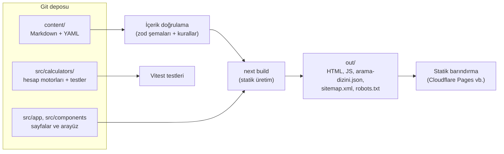

# Mimari

## Genel bakış

Maden360, **tamamen statik** üretilen bir Next.js uygulamasıdır (`output: 'export'`). Derleme sırasında
tüm sayfalar HTML olarak `out/` klasörüne yazılır; sunucu, veritabanı veya giriş sistemi gerekmez.
Bu sayede Cloudflare Pages, Netlify veya GitHub Pages gibi ücretsiz statik barındırma hizmetlerinde
çalışır.



| Katman | Teknoloji | Not |
|---|---|---|
| Çatı | Next.js 16 (App Router), React 19 | Statik dışa aktarma |
| Dil | TypeScript 6 (strict) | |
| Stil | Tailwind CSS 4 + Typography | Tasarım belirteçleri `src/app/globals.css` |
| İçerik | Markdown + YAML ön bilgi | unified/remark/rehype, KaTeX formüller |
| Doğrulama | zod 4 | Hatalı içerik derlemeyi durdurur |
| Arama | MiniSearch (tarayıcıda) | Türkçeye uyarlanmış dizinleme |
| Test | Vitest | Hesap motorları, içerik kuralları, arama |
| Yazı tipi | Inter (fontsource, kendi sunucumuzdan) | Dış yazı tipi servisi yok |

## Klasör yapısı

```text
content/                  İçerik (editörlerin çalıştığı yer)
  makaleler/*.md          Bilgi merkezi makaleleri
  sozluk/*.md             Sözlük terimleri
  hesaplamalar/*.md       Hesaplayıcı açıklama sayfaları
  sayfalar/*.md           Hakkımızda, politikalar, iletişim, ilan kuralları, KVKK metni
  fuar/*.md               Sanal fuar standları (firma vitrinleri)
  is-ilanlari/*.md        İş ilanları (işçi arayanlar)
  is-arayanlar/*.md       Aday profilleri (kişisel veri içermez; dosya adı = başvuru no)
  market/*.md             Market ilanları (ekipman, parça, hizmet, cevher, saha)
  fuar-salonlari.yaml     Sanal fuar salonları
  market-kategorileri.yaml Market kategorileri ve yasal notları
  meslekler.yaml          Meslek / pozisyon listesi
  konular.yaml            Konular (kategoriler)
  etiketler.yaml          Etiketler
  kaynaklar.yaml          Kaynak kayıtları
  kisiler.yaml            Yazarlar ve teknik inceleyiciler
  rehber.yaml             Sektör rehberi bölümleri
  _sablonlar/             Yeni içerik şablonları
src/
  app/                    Sayfalar (rotalar), site haritası, robots, arama dizini
  calculators/            Hesap motorları (saf TypeScript) ve testleri
    core/                 Ortak tipler, sayı ayrıştırma, birimler, girdi okuma
  components/             Arayüz bileşenleri
  config/site.ts          Site adı, adres, iletişim (tek yapılandırma noktası)
  i18n/                   URL yapısı ve menüler (İngilizceye hazır)
  lib/content/            İçerik şemaları, yükleme, Markdown işleme, doğrulama
  lib/search/             Arama motoru ve dizin üretimi
  lib/seo/                Meta veriler ve yapılandırılmış veri (JSON-LD)
  lib/listings/           İlan seçenekleri, tarih/süre, iletişim bilgisi denetimi, kart verisi
  lib/submissions/        Başvuru formu tanımları, doğrulama, taslak dosya üretimi, gönderim
  components/listings/    İlan kartları, süzme, ilan sayfası parçaları
  components/forms/       Erişilebilir başvuru formu
scripts/                  Doğrulama, site denetimi, yerel sunucu, içerik oluşturma
docs/                     Belgeler
```

## Veri modeli ve dosya karşılıkları

Ürün planındaki veri modeli ([urun-plani.md](urun-plani.md#6-veri-modeli)) v1'de veritabanı yerine
Git'teki dosyalarla karşılanır:

| Plandaki varlık | v1 karşılığı |
|---|---|
| CATEGORY | `content/konular.yaml` |
| ARTICLE | `content/makaleler/<slug>.md` (ön bilgi + gövde) |
| ARTICLE_SOURCE (claim_note) | Makale ön bilgisindeki `sources: [{ id, note, locator }]` |
| SOURCE | `content/kaynaklar.yaml` |
| TAG / ARTICLE_TAG | `content/etiketler.yaml` / ön bilgideki `tags` |
| CALCULATOR | Hesap motoru `src/calculators/<slug>.ts` (formül, girdi ve birim şeması, varsayımlar, `version` = test sürümü) + açıklama `content/hesaplamalar/<slug>.md` |
| CALCULATOR_SOURCE | Hesaplayıcı açıklamasındaki `sources` |
| (ek) TERM | `content/sozluk/<slug>.md` |
| (ek) PERSON | `content/kisiler.yaml` (yazar ve inceleyiciler) |
| revisions | Git geçmişi + içerikteki `corrections` (düzeltme geçmişi) |
| (ek) HALL / STAND | `content/fuar-salonlari.yaml` / `content/fuar/<firma>.md` |
| (ek) POSITION / JOB / CANDIDATE | `content/meslekler.yaml` / `content/is-ilanlari/*.md` / `content/is-arayanlar/<başvuru-no>.md` |
| (ek) MARKET_CATEGORY / MARKET_LISTING | `content/market-kategorileri.yaml` / `content/market/*.md` |

İleride veritabanına geçilirse (`users`, `roles`, `revisions`, `calculator_tests`, `translations`,
`organizations`) bu dosyalar doğrudan tablolara aktarılabilir; zod şemaları tablo yapısının taslağıdır.

## Yayın kuralı (görünürlük)

`src/lib/content/visibility.ts`:

| Ortam | Görünen içerik | Arama motoru |
|---|---|---|
| `npm run dev` | Tümü (taslaklar uyarı bandıyla) | — |
| `npm run build:onizleme` (`CONTENT_PREVIEW=1`) | Tümü | Kapalı (`noindex`, robots `Disallow: /`) |
| `npm run build` (üretim) | Yalnızca `published` | Açık; site haritası yalnızca yayımlanmışları listeler |

İlanlarda ayrıca: süresi dolan (`expiresAt` geçmiş, Türkiye saati) ve örnek (`example: true`) ilanlar
üretim derlemesine girmez; tarayıcı da süresi dolan ilanı listelerden ve aramadan gizler. İlan kuralları
ve KVKK sayfaları (`/[sayfa]` rotası) yalnızca yayımlandıklarında üretilir ve başvuru formları bu iki
sayfa yayımlanınca açılır (`areSubmissionsOpen`).

Statik dışa aktarma her dinamik rotanın en az bir sayfa üretmesini ister. Bir bölümde henüz yayımlanmış
içerik yoksa `src/lib/static-params.ts` 404 gösteren bir yer tutucu sayfa üretir; ilk içerik
yayımlandığında kendiliğinden kaybolur.

## Hesap motorları

Her hesaplayıcı bir `CalculatorDefinition` nesnesidir (`src/calculators/core/types.ts`): girdi alanları,
birimler, formüller (KaTeX), varsayımlar, sınırlar, örnek ve saf bir `compute(values)` fonksiyonu.
`compute` metin girdileri alır, Türkçe sayı biçimlerini ayrıştırır (`2,65` / `1.250.000`), birimleri
temel birime çevirir, alan ve alanlar arası kuralları uygular ve ya sonuç ya da hata listesi döndürür;
asla istisna fırlatmaz. Aynı kod tarayıcıda ve testlerde çalışır. Ayrıntılar:
[hesaplayici-gelistirme.md](hesaplayici-gelistirme.md).

## Arama

Derleme sırasında `/arama-dizini.json` üretilir (yalnızca görünür içerikler). Arama sayfası bu dosyayı
bir kez indirip MiniSearch ile tarayıcıda arar:

- Türkçe karakter katlama: "kömür" = "komur", "İşletme" = "isletme".
- Sondan eklemeli yapıya uyum: kelimeler hem tam hem ilk 5 harfiyle (F5 kökü) dizinlenir;
  "kazanımların" sorgusu "kazanım" içeren belgeleri bulur.
- Kademeli arama: önce tam/önek eşleşme, sonuç yoksa yazım hatası toleransı, yine yoksa
  herhangi bir kelimeyle eşleşme.

## Çok dilliliğe hazırlık

Tüm bağlantılar `src/i18n/routes.ts` üzerinden üretilir. İngilizce eklendiğinde aynı içerik
`/en/knowledge/...` gibi kendi segment adlarıyla yayımlanacak; Türkçe URL'ler değişmeyecek. İçerik
ön bilgisindeki `language` ve `translationKey` alanları çevirileri eşleştirmek için ayrılmıştır.

## SEO

- Her sayfada özgün `<title>`, meta açıklama, kanonik URL ve Open Graph etiketleri (`src/lib/seo/metadata.ts`).
- Yapılandırılmış veri: WebSite + Organization, TechArticle, DefinedTerm, WebApplication, BreadcrumbList;
  yayımlanmış iş ilanlarında JobPosting, fuar standlarında Organization.
- Aday profilleri ve iletişim talebi sayfası `noindex`'tir; aday profilleri site haritasına ve arama
  dizinine girmez.
- `sitemap.xml`, `robots.txt`, `manifest.webmanifest` derlemede üretilir.
- `npm run site:check` derleme çıktısındaki tüm sayfaları denetler (bkz. [kabul-kriterleri.md](kabul-kriterleri.md)).

## Performans

- Tüm sayfalar derleme sırasında HTML olarak üretilir; içerik, JavaScript yüklenmeden okunabilir.
- Görsel servis, video, dış yazı tipi veya izleme betiği yoktur. Inter yazı tipi siteyle birlikte sunulur
  ve yalnızca gereken karakter alt kümeleri (Latin + Latin genişletilmiş) indirilir.
- Sayfa başına JavaScript'in büyük kısmı (~165 KB gzip) Next.js ve React çatısının temel yüküdür; sitenin
  kendi kodu ~10 KB gzip'tir. KaTeX formülleri sunucuda işlenir, tarayıcıya KaTeX kütüphanesi gönderilmez.
- Arama dizini (~25 KB gzip) yalnızca arama sayfasında, ilk aramada indirilir.

## Güvenlik notları

- Markdown içinde ham HTML devre dışıdır; dış bağlantılara `rel="noopener noreferrer"`, kullanıcı
  içeriğindeki (ilan, stand) dış bağlantılara ayrıca `nofollow ugc` eklenir. Web adresleri yalnızca
  `http(s)` olabilir.
- JSON-LD çıktısında `<` karakteri kaçışlanır.
- Çerez ve izleme betiği kullanılmaz. Sitede veri saklanmaz: ilan başvuruları ziyaretçinin e-posta
  programıyla (veya isteğe bağlı form hizmetiyle) doğrudan editöre gider; formlarda bot tuzağı alanı
  vardır. Kişisel veri işleme KVKK aydınlatma metninde açıklanır.
- `npm audit`'te kalan bulgu yalnızca geliştirme aracı (ESLint) bağımlılığındadır; yayımlanan siteye girmez.
