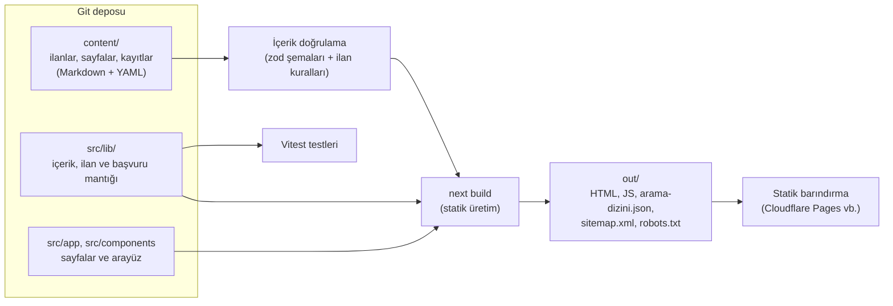

# Mimari

## Genel bakış

Maden360, **tamamen statik** üretilen bir Next.js uygulamasıdır (`output: 'export'`). Derleme sırasında
tüm sayfalar HTML olarak `out/` klasörüne yazılır; sunucu, veritabanı veya giriş sistemi gerekmez.
Bu sayede Cloudflare Pages, Netlify veya GitHub Pages gibi ücretsiz statik barındırma hizmetlerinde
çalışır.



| Katman | Teknoloji | Not |
|---|---|---|
| Çatı | Next.js 16 (App Router), React 19 | Statik dışa aktarma |
| Dil | TypeScript 6 (strict) | |
| Stil | Tailwind CSS 4 + Typography | Tasarım belirteçleri `src/app/globals.css` |
| İçerik | Markdown + YAML ön bilgi | unified/remark/rehype (GFM tabloları); ham HTML kapalı |
| Doğrulama | zod 4 | Hatalı içerik derlemeyi durdurur |
| Arama | MiniSearch (tarayıcıda) | Türkçeye uyarlanmış dizinleme |
| Test | Vitest | İçerik ve ilan kuralları, başvuru formları, sayı okuma, arama |
| Yazı tipi | Inter (fontsource, kendi sunucumuzdan) | Dış yazı tipi servisi yok |

## Klasör yapısı

```text
content/                  İçerik (editörlerin çalıştığı yer)
  fuar/*.md               Sanal fuar standları (firma vitrinleri)
  is-ilanlari/*.md        İş ilanları (işçi arayanlar)
  is-arayanlar/*.md       Aday profilleri (kişisel veri içermez; dosya adı = başvuru no)
  market/*.md             Market ilanları (ekipman, parça, hizmet, cevher, saha)
  sayfalar/*.md           Hakkımızda, iletişim, ilan kuralları, KVKK aydınlatma metni
  fuar-salonlari.yaml     Sanal fuar salonları
  market-kategorileri.yaml Market kategorileri ve yasal notları (resmî dayanaklarıyla)
  meslekler.yaml          Meslek / pozisyon listesi
  kisiler.yaml            İlan editörleri
  _sablonlar/             Yeni ilan şablonları
src/
  app/                    Sayfalar (rotalar), site haritası, robots, arama dizini
  components/             Arayüz bileşenleri
    listings/             İlan kartları, süzme, ilan sayfası parçaları
    forms/                Erişilebilir başvuru formu
  config/site.ts          Site adı, adres, iletişim (tek yapılandırma noktası)
  i18n/                   URL yapısı ve menüler (İngilizceye hazır)
  lib/content/            İçerik şemaları, yükleme, Markdown işleme, doğrulama
  lib/listings/           İlan seçenekleri, tarih/süre, iletişim bilgisi denetimi, kart verisi
  lib/submissions/        Başvuru formu tanımları, doğrulama, taslak dosya üretimi, gönderim
  lib/search/             Arama motoru ve dizin üretimi
  lib/seo/                Meta veriler ve yapılandırılmış veri (JSON-LD)
  lib/number.ts           Türkçe ve uluslararası sayı yazımlarını okuma
scripts/                  Doğrulama, site denetimi, yerel sunucu, ilan dosyası oluşturma
docs/                     Belgeler
```

## Veri modeli ve dosya karşılıkları

Ürün planındaki veri modeli ([urun-plani.md](urun-plani.md#11-kapsam-güncellemesi-sanal-fuar-iş-ilanları-ve-market))
v1'de veritabanı yerine Git'teki dosyalarla karşılanır:

| Plandaki varlık | v1 karşılığı |
|---|---|
| HALL / STAND | `content/fuar-salonlari.yaml` / `content/fuar/<firma>.md` |
| POSITION / JOB / CANDIDATE | `content/meslekler.yaml` / `content/is-ilanlari/*.md` / `content/is-arayanlar/<başvuru-no>.md` |
| MARKET_CATEGORY / MARKET_LISTING | `content/market-kategorileri.yaml` / `content/market/*.md` |
| NOTICE / REFERENCE | Kategori kaydındaki `notice` ve `notice.references` (resmî metin, madde, son kontrol tarihi) |
| PERSON | `content/kisiler.yaml` (ilan editörleri; `canModerate`) |
| PAGE | `content/sayfalar/<slug>.md` |
| revisions | Git geçmişi |

Bilgi Merkezi, Sözlük ve Hesaplamalar'a ait varlıklar (ARTICLE, SOURCE, TAG, CATEGORY, CALCULATOR, TERM)
16 Ekim 2026'da kaldırıldı ([urun-plani.md §12](urun-plani.md#12-kapsam-güncellemesi-bilgi-merkezi-sözlük-ve-hesaplamalar-kaldırıldı)).

İleride veritabanına geçilirse (`users`, `roles`, `revisions`, `translations`, `organizations`) bu
dosyalar doğrudan tablolara aktarılabilir; zod şemaları tablo yapısının taslağıdır.

## Yayın kuralı (görünürlük)

`src/lib/content/visibility.ts`:

| Ortam | Görünen içerik | Arama motoru |
|---|---|---|
| `npm run dev` | Tümü (taslaklar uyarı bandıyla) | — |
| `npm run build:onizleme` (`CONTENT_PREVIEW=1`) | Tümü | Kapalı (`noindex`, robots `Disallow: /`) |
| `npm run build` (üretim) | Yalnızca `published` | Açık; site haritası yalnızca yayımlanmışları listeler |

İlanlarda ayrıca: süresi dolan (`expiresAt` geçmiş, Türkiye saati) ve örnek (`example: true`) ilanlar
üretim derlemesine girmez; tarayıcı da süresi dolan ilanı listelerden ve aramadan gizler. İlan kuralları
ve KVKK sayfaları (`/[sayfa]` rotası) yalnızca yayımlandıklarında üretilir ve başvuru formları bu iki
sayfa yayımlanınca açılır (`areSubmissionsOpen`).

Statik dışa aktarma her dinamik rotanın en az bir sayfa üretmesini ister. Bir bölümde henüz yayımlanmış
ilan yoksa `src/lib/static-params.ts` 404 gösteren bir yer tutucu sayfa üretir; ilk ilan yayımlandığında
kendiliğinden kaybolur.

## Arama

Derleme sırasında `/arama-dizini.json` üretilir: yalnızca görünür fuar standları, iş ilanları ve market
ilanları (aday profilleri kişisel veri içerdiği için dizine girmez). Arama sayfası bu dosyayı bir kez
indirip MiniSearch ile tarayıcıda arar; süresi dolan ilanları sonuçlardan çıkarır:

- Türkçe karakter katlama: "kırıcı" = "kirici", "İşletme" = "isletme".
- Sondan eklemeli yapıya uyum: kelimeler hem tam hem ilk 5 harfiyle (F5 kökü) dizinlenir;
  "ekskavatörler" sorgusu "ekskavatör" içeren ilanları bulur.
- Kademeli arama: önce tam/önek eşleşme, sonuç yoksa yazım hatası toleransı, yine yoksa
  herhangi bir kelimeyle eşleşme.

## Çok dilliliğe hazırlık

Tüm bağlantılar `src/i18n/routes.ts` üzerinden üretilir. İngilizce eklendiğinde aynı içerik
`/en/expo/...`, `/en/jobs/...` gibi kendi segment adlarıyla yayımlanacak; Türkçe URL'ler değişmeyecek.
Çevirileri eşleştiren alanlar (ör. `translationKey`) İngilizce eklendiğinde şemalara eklenecek.

## SEO

- Her sayfada özgün `<title>`, meta açıklama, kanonik URL ve Open Graph etiketleri (`src/lib/seo/metadata.ts`).
- Yapılandırılmış veri: WebSite + Organization, BreadcrumbList; yayımlanmış iş ilanlarında JobPosting,
  fuar standlarında Organization (örnek ve süresi dolmuş ilanlarda üretilmez).
- Aday profilleri ve iletişim talebi sayfası `noindex`'tir; aday profilleri site haritasına ve arama
  dizinine girmez.
- `sitemap.xml`, `robots.txt`, `manifest.webmanifest` derlemede üretilir.
- `npm run site:check` derleme çıktısındaki tüm sayfaları denetler (bkz. [kabul-kriterleri.md](kabul-kriterleri.md)).

## Performans

- Tüm sayfalar derleme sırasında HTML olarak üretilir; içerik, JavaScript yüklenmeden okunabilir.
- Görsel servis, video, dış yazı tipi veya izleme betiği yoktur. Inter yazı tipi siteyle birlikte sunulur
  ve yalnızca gereken karakter alt kümeleri (Latin + Latin genişletilmiş) indirilir.
- Sayfa başına JavaScript (gzip): ana sayfa ~179 KB, fuar ve market ~189 KB, başvuru formu ~192 KB. Büyük
  kısmı Next.js ve React çatısının temel yüküdür; süzme ve form kodu yalnızca ilgili sayfalarda yüklenir.
- Arama dizini yalnızca arama sayfasında indirilir ve yalnızca yayımlanmış ilanları içerir.

## Güvenlik notları

- Markdown içinde ham HTML devre dışıdır; dış bağlantılara `rel="noopener noreferrer"`, kullanıcı
  içeriğindeki (ilan, stand) dış bağlantılara ayrıca `nofollow ugc` eklenir. Web adresleri yalnızca
  `http(s)` olabilir.
- JSON-LD çıktısında `<` karakteri kaçışlanır.
- Çerez ve izleme betiği kullanılmaz. Sitede veri saklanmaz: ilan başvuruları ziyaretçinin e-posta
  programıyla (veya isteğe bağlı form hizmetiyle) doğrudan editöre gider; formlarda bot tuzağı alanı
  vardır. Kişisel veri işleme KVKK aydınlatma metninde açıklanır.
- `npm audit`'te kalan bulgu yalnızca geliştirme aracı (ESLint) bağımlılığındadır; yayımlanan siteye girmez.
