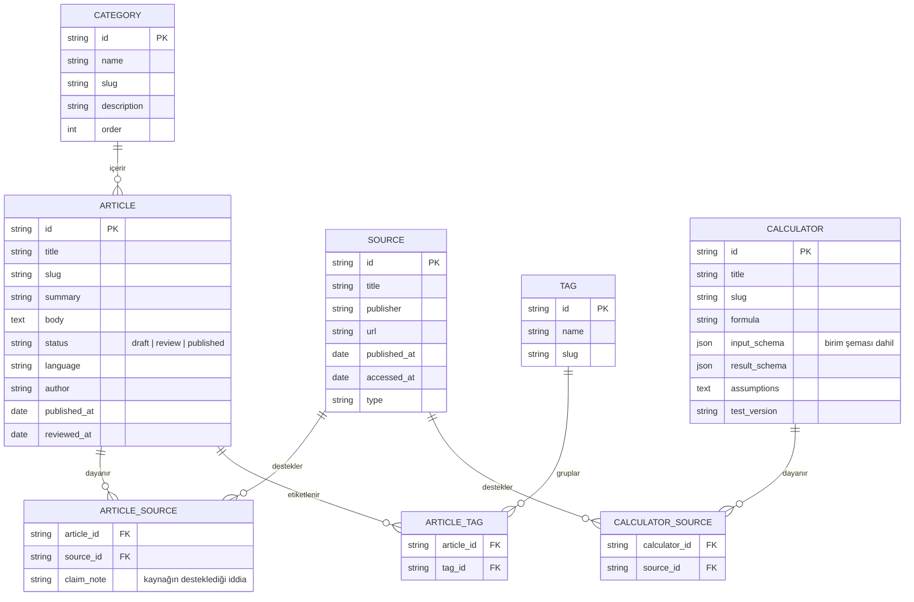

# Ürün planı — Türkiye Madencilik Bilgi ve Hesaplama Platformu

> Bu belge, proje başlangıcında paylaşılan ürün planının düzenlenmiş hâlidir. Uygulamadaki karşılıkları
> [mimari.md](mimari.md) ve [kabul-kriterleri.md](kabul-kriterleri.md) belgelerinde açıklanır.
> Çalışma adı **Maden360**'tır; ad, `src/config/site.ts` dosyasından tek noktada değiştirilebilir.

## 1. Ürün tanımı

Türkiye'deki madencilik profesyonelleri için bir **dijital başvuru ve hesaplama platformu**. Haber sitesi değildir.

| Karar | İçerik |
|---|---|
| Pazar | Önce Türkiye; İngilizce (`/en`) sonra |
| Ana ürün | Teknik hesaplayıcılar |
| İçerik | Kaynaklı teknik rehberler |
| Bütçe | Ücretsiz katmanlar (statik barındırma, açık kaynak araçlar) |

**Hedef kitle:** Maden mühendisleri, teknikerler, cevher hazırlama ve zenginleştirme çalışanları, maden işletmesi yöneticileri, öğrenciler; taş ocağı, dekapaj ve nakliyat firmaları.

## 2. Kapsam

### v1 (MVP) modülleri

1. **Bilgi merkezi:** Kategorili ve aranabilir makaleler.
2. **Hesaplama merkezi:** Formülleri açıklanmış ve test edilmiş hesaplayıcılar.
3. **Sektör rehberi:** Maden türleri, yöntemler, terimler, sözlük.
4. **Kaynak sistemi:** Her teknik içerikte kaynak, tarih ve doğrulama durumu.
5. **Arama:** Makale, terim ve hesaplayıcılarda arama.
6. **Mobil uyum.**
7. **SEO:** Her içerik için özgün başlık, açıklama ve dizinlenebilir URL.
8. **Yönetim:** İçerik ekleme, düzenleme ve yayımlama iş akışı.

### v1'de olmayacaklar

- Üyelik, kullanıcı profili, sosyal özellikler
- Kullanıcıların ilan verdiği pazar yeri
- Ödeme ve abonelik
- Gerçek zamanlı emtia veya borsa fiyatları
- Karmaşık işletme yönetimi yazılımı
- Doğrulanmamış, yapay zekâ üretimi teknik cevaplar
- Madende doğrudan kontrol veya güvenlik kararı veren yazılım

## 3. URL yapısı

| Adres | İçerik |
|---|---|
| `/` | Ana sayfa |
| `/bilgi`, `/bilgi/[slug]` | Bilgi merkezi ve makaleler |
| `/konular/[slug]` | Konu (kategori) sayfaları |
| `/hesaplamalar`, `/hesaplamalar/[slug]` | Hesaplayıcılar |
| `/rehber` | Sektör rehberi: maden türleri, terimler, meslekler, süreçler, teknik kavramlar |
| `/sozluk`, `/sozluk/[slug]` | Madencilik sözlüğü |
| `/ara?q=...` | Arama |
| `/hakkimizda`, `/kaynak-politikasi`, `/duzeltme-politikasi`, `/iletisim` | Güven sayfaları |

- İngilizce sürüm `/en/...` altında, Türkçe URL'leri bozmadan eklenebilmelidir.
- Bir yönetim alanı eklenirse `/yonetim` altında olmalı ve kimlik doğrulama ile yetkilendirme gerektirmelidir.

## 4. Hesaplayıcılar

**Konu alanları:** Üretim planlama (tonaj–hacim, dekapaj oranı), cevher hazırlama ve zenginleştirme (kütle verimi, besleme ve ürün tenörü, metal kazanımı, konsantre miktarı), nakliyat (kamyon, bant konveyör), vardiya ve üretim performansı.

**Kurallar:**

- Dekapaj oranında pasa ve cevher aynı bazda olmalıdır (t/t veya m³/m³). **Farklı bazlar karıştırılmaz.**
- Tonaj = Hacim × Yoğunluk (m³ × t/m³ → t); geometrik şekil ve yoğunluk seçimi açıkça belirtilmelidir.
- Zenginleştirme formülleri geçerlilik varsayımlarını göstermelidir.
- Nakliyat araçları teorik ve fiili kapasiteyi ayrı göstermelidir.
- Havalandırma, tahkimat, patlatma ve İSG hesapları, mesleki doğrulama ve ilgili standartlar olmadan saha kararında kullanılmamalıdır.
- İlk sürümde yalnızca dört hesaplayıcı yayımlanabilir: **tonaj–hacim, dekapaj oranı, kütle verimi/kazanım, vardiya hedefi** — hepsi testli.

Her hesaplayıcı şunları içerir: formül, birimler, girdi alanları, sonuçlar, örnek ve sınırlar. Hesap fonksiyonları arayüzden bağımsızdır; birim dönüşümü, geçersiz girdi kontrolü, bilinen örneklerle testler ve formül/varsayım/sonuç açıklamaları zorunludur.

## 5. İçerik ve kaynak kuralları

- Yapay zekâ ile yazılan metin, kaynak doğrulaması ve teknik inceleme yapılmadan yayımlanmaz.
- Standartların tam metni izinsiz kopyalanmaz.
- İçerik durumları: **taslak (draft) → incelemede (review) → yayımlandı (published)**. Yayından sonra kaynak, inceleme tarihi ve düzeltme geçmişi izlenebilir kalmalıdır.
- Her makalede: iddialara bağlı kaynaklar; ilk yayın ve son gözden geçirme tarihi; yazar ve teknik inceleyen; gerektiğinde düzeltme notu; mevzuat içeriğinde yürürlük tarihi ve değişiklik bilgisi.
- **Kaynak önceliği:** Resmî kurumlar (MAPEG, MTA, Resmî Gazete) → akademik ve teknik kaynaklar → mevzuat ve standartlar → sektör haberleri.

## 6. Veri modeli

**İleride veritabanına geçildiğinde eklenecek tablolar:** `users`, `roles`, `revisions`, `calculator_tests`, `translations`, `organizations`.

## 7. Tasarım ilkeleri

- **Renkler:** Koyu grafit, bakır/turuncu vurgu, açık taş tonu ve beyaz.
- **Görünüm:** Modern mühendislik yayını; arama ve gezinme üstte.
- **Okunabilirlik önce gelir:** Gereksiz animasyon, video arka plan ve pahalı görsel servisleri yok.
- **Mobil:** Büyük dokunma alanları, tek sütunlu formlar, okunur tablolar, yatay taşma yok.
- **Erişilebilirlik:** Klavyeyle kullanılabilir formlar, görünür odak, etiketli girdiler, yeterli kontrast.

## 8. Teknik yaklaşım

- Next.js + TypeScript, Tailwind CSS, Markdown/MDX içerik.
- Formüller saf TypeScript fonksiyonları olarak yazılır ve test edilir.
- Önce yerel (tarayıcı içi) arama.
- PostgreSQL/Supabase yalnızca gerektiğinde.
- Statik veya düşük maliyetli Node barındırma.
- v1'de giriş, veritabanı veya sunucu tarafı hesaplama gerekmez; içerik sayfaları mümkün olduğunca statik üretilir.

## 9. Fazlar

| Faz | Kapsam |
|---|---|
| 1. İskelet | Gezinme, alt bilgi, mobil menü, hata sayfaları, SEO meta verileri |
| 2. Ana sayfa ve bilgi mimarisi | Markdown içerik, makale şablonu, kaynak gösterimi |
| 3. Hesaplama motoru | Arayüzden bağımsız fonksiyonlar, birim dönüşümü, geçersiz girdi kontrolü, bilinen örnek testleri, formül/varsayım/sonuç açıklamaları |
| 4. Arama ve sözlük | Arama, sözlük, kaynaklar, inceleme bilgisi, sonuç bulunamadı ekranı |
| 5. Kalite | Mobil, erişilebilirlik, performans, kırık bağlantılar, SEO denetimleri, formül ve kaynak kontrolü, yedekleme, hata günlükleri, yayına alma kontrol listesi |
| 6. Analitik ve gelir | Sonraki aşama |

## 10. Kabul kriterleri

1. Ana sayfa ve tüm temel sayfalar hatasız açılır.
2. Yerleşim telefonda ve masaüstünde çalışır.
3. İlk dört hesaplayıcı beklenen sonuç testlerini geçer.
4. Geçersiz, eksik ve sıfıra bölme oluşturan girdiler ele alınır.
5. Makalelerde kaynak ve inceleme bilgisi görünür.
6. Arama, kategori gezinmesi ve sözlük bağlantıları çalışır.
7. Her içeriğin başlığı, açıklaması ve kanonik URL'si vardır.
8. Gizli bir yönetim alanı varsa kimlik doğrulamayla korunur.
9. Yayına alma ve geri alma adımları belgelenmiştir.
