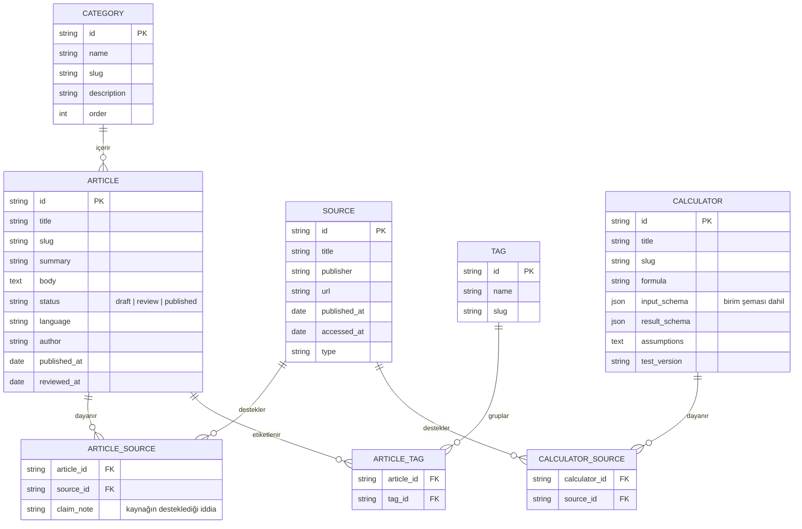
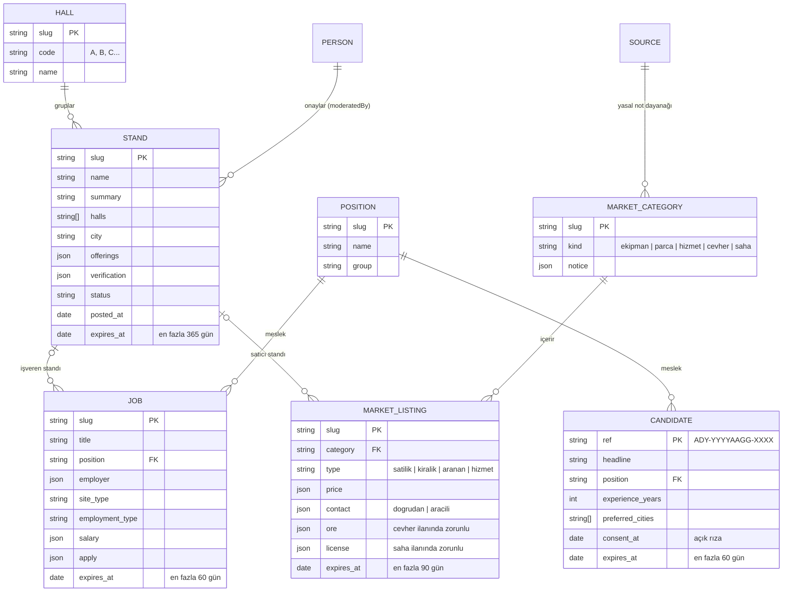
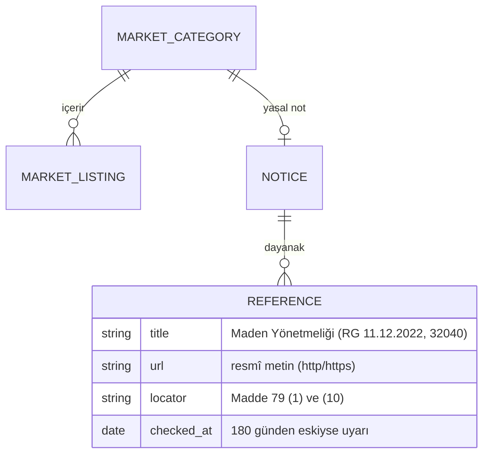

# Ürün planı — Maden360

> Bu belge, proje başlangıcında paylaşılan ürün planının ("Türkiye Madencilik Bilgi ve Hesaplama
> Platformu") düzenlenmiş hâlidir. Uygulamadaki karşılıkları [mimari.md](mimari.md) ve
> [kabul-kriterleri.md](kabul-kriterleri.md) belgelerinde açıklanır. Çalışma adı **Maden360**'tır; ad,
> `src/config/site.ts` dosyasından tek noktada değiştirilebilir.

> **Güncel kapsam (16 Ekim 2026):** Platform bir **madencilik sektör ağıdır**: Sanal Fuar, İş İlanları
> ve Market ([§11](#11-kapsam-güncellemesi-sanal-fuar-iş-ilanları-ve-market)). Bilgi Merkezi, Sözlük ve
> Hesaplamalar kaldırıldı ([§12](#12-kapsam-güncellemesi-bilgi-merkezi-sözlük-ve-hesaplamalar-kaldırıldı)).
> §1–§10 karar geçmişi olarak korunur; kaldırılan maddeler işaretlenmiştir.

## 1. Ürün tanımı

Türkiye'deki madencilik profesyonelleri için bir **dijital başvuru ve hesaplama platformu**. Haber sitesi değildir.

| Karar | İçerik |
|---|---|
| Pazar | Önce Türkiye; İngilizce (`/en`) sonra |
| Ana ürün | Teknik hesaplayıcılar |
| İçerik | Kaynaklı teknik rehberler |
| Bütçe | Ücretsiz katmanlar (statik barındırma, açık kaynak araçlar) |

**Hedef kitle:** Maden mühendisleri, teknikerler, cevher hazırlama ve zenginleştirme çalışanları, maden işletmesi yöneticileri, öğrenciler; taş ocağı, dekapaj ve nakliyat firmaları.

## 2. Kapsam

### v1 (MVP) modülleri

1. ~~**Bilgi merkezi:** Kategorili ve aranabilir makaleler.~~ *Kaldırıldı (§12).*
2. ~~**Hesaplama merkezi:** Formülleri açıklanmış ve test edilmiş hesaplayıcılar.~~ *Kaldırıldı (§12).*
3. ~~**Sektör rehberi:** Maden türleri, yöntemler, terimler, sözlük.~~ *Kaldırıldı (§12).*
4. ~~**Kaynak sistemi:** Her teknik içerikte kaynak, tarih ve doğrulama durumu.~~ *Kaldırıldı (§12);
   mevzuata dayanan yasal notlarda resmî dayanak ve kontrol tarihi gösterilmeye devam eder.*
5. **Arama:** ~~Makale, terim ve hesaplayıcılarda arama.~~ Fuar standları, iş ilanları ve market
   ilanlarında arama (§12).
6. **Mobil uyum.**
7. **SEO:** Her içerik için özgün başlık, açıklama ve dizinlenebilir URL.
8. **Yönetim:** İçerik ekleme, düzenleme ve yayımlama iş akışı.

### v1'de olmayacaklar

- Üyelik, kullanıcı profili, sosyal özellikler
- Kullanıcıların ilan verdiği pazar yeri — *16 Ekim 2026'da güncellendi:* üyelik ve ödeme olmadan,
  başvuru formu + editör onayıyla çalışan ilan bölümleri eklendi (bkz. [§11](#11-kapsam-güncellemesi-sanal-fuar-iş-ilanları-ve-market))
- Ödeme ve abonelik
- Gerçek zamanlı emtia veya borsa fiyatları
- Karmaşık işletme yönetimi yazılımı
- Doğrulanmamış, yapay zekâ üretimi teknik cevaplar
- Madende doğrudan kontrol veya güvenlik kararı veren yazılım

## 3. URL yapısı

| Adres | İçerik |
|---|---|
| `/` | Ana sayfa |
| ~~`/bilgi`, `/bilgi/[slug]`~~ | ~~Bilgi merkezi ve makaleler~~ — kaldırıldı (§12) |
| ~~`/konular/[slug]`~~ | ~~Konu (kategori) sayfaları~~ — kaldırıldı (§12) |
| ~~`/hesaplamalar`, `/hesaplamalar/[slug]`~~ | ~~Hesaplayıcılar~~ — kaldırıldı (§12) |
| ~~`/rehber`~~ | ~~Sektör rehberi~~ — kaldırıldı (§12) |
| ~~`/sozluk`, `/sozluk/[slug]`~~ | ~~Madencilik sözlüğü~~ — kaldırıldı (§12) |
| `/ara?q=...` | Arama |
| `/hakkimizda`, `/iletisim` | Güven sayfaları (~~`/kaynak-politikasi`, `/duzeltme-politikasi`~~ kaldırıldı, §12) |
| `/fuar`, `/fuar/salonlar/[salon]`, `/fuar/[firma]` | Sanal fuar (§11) |
| `/is-ilanlari`, `/is-ilanlari/[slug]`, `/is-arayanlar`, `/is-arayanlar/[no]` | İş ilanları ve aday profilleri (§11) |
| `/market`, `/market/kategori/[kategori]`, `/market/[slug]` | Market (§11) |
| `/ilan-ver`, `/ilan-ver/[tür]`, `/iletisim-talebi`, `/ilan-kurallari`, `/kvkk` | Başvuru formları ve kurallar (§11) |

- İngilizce sürüm `/en/...` altında, Türkçe URL'leri bozmadan eklenebilmelidir.
- Bir yönetim alanı eklenirse `/yonetim` altında olmalı ve kimlik doğrulama ile yetkilendirme gerektirmelidir.

## 4. Hesaplayıcılar

> *16 Ekim 2026'da kapsamdan çıkarıldı (§12). Aşağıdaki kurallar, hesaplayıcılar ileride yeniden
> eklenirse geçerlidir.*

**Konu alanları:** Üretim planlama (tonaj–hacim, dekapaj oranı), cevher hazırlama ve zenginleştirme (kütle verimi, besleme ve ürün tenörü, metal kazanımı, konsantre miktarı), nakliyat (kamyon, bant konveyör), vardiya ve üretim performansı.

**Kurallar:**

- Dekapaj oranında pasa ve cevher aynı bazda olmalıdır (t/t veya m³/m³). **Farklı bazlar karıştırılmaz.**
- Tonaj = Hacim × Yoğunluk (m³ × t/m³ → t); geometrik şekil ve yoğunluk seçimi açıkça belirtilmelidir.
- Zenginleştirme formülleri geçerlilik varsayımlarını göstermelidir.
- Nakliyat araçları teorik ve fiili kapasiteyi ayrı göstermelidir.
- Havalandırma, tahkimat, patlatma ve İSG hesapları, mesleki doğrulama ve ilgili standartlar olmadan saha kararında kullanılmamalıdır.
- İlk sürümde yalnızca dört hesaplayıcı yayımlanabilir: **tonaj–hacim, dekapaj oranı, kütle verimi/kazanım, vardiya hedefi** — hepsi testli.

Her hesaplayıcı şunları içerir: formül, birimler, girdi alanları, sonuçlar, örnek ve sınırlar. Hesap fonksiyonları arayüzden bağımsızdır; birim dönüşümü, geçersiz girdi kontrolü, bilinen örneklerle testler ve formül/varsayım/sonuç açıklamaları zorunludur.

## 5. İçerik ve kaynak kuralları

- Yapay zekâ ile yazılan metin, kaynak doğrulaması ve teknik inceleme yapılmadan yayımlanmaz.
- Standartların tam metni izinsiz kopyalanmaz.
- İçerik durumları: **taslak (draft) → incelemede (review) → yayımlandı (published)**. Yayından sonra kaynak, inceleme tarihi ve düzeltme geçmişi izlenebilir kalmalıdır.
- Her makalede: iddialara bağlı kaynaklar; ilk yayın ve son gözden geçirme tarihi; yazar ve teknik inceleyen; gerektiğinde düzeltme notu; mevzuat içeriğinde yürürlük tarihi ve değişiklik bilgisi.
- **Kaynak önceliği:** Resmî kurumlar (MAPEG, MTA, Resmî Gazete) → akademik ve teknik kaynaklar → mevzuat ve standartlar → sektör haberleri.

## 6. Veri modeli



**İleride veritabanına geçildiğinde eklenecek tablolar:** `users`, `roles`, `revisions`, `calculator_tests`, `translations`, `organizations`.

## 7. Tasarım ilkeleri

- **Renkler:** Grafit, bakır, taş ve beyaz. 16 Ekim 2026'da tek tema korunarak renkler canlandırıldı.
  22 Ekim 2026'da kullanıcı kararıyla krem zemin yerine beyaz ve soğuk taş grisi zemine geçildi; bakır
  koyulaştı ve yalnızca bağlantı, ana düğme, etkin menü ve salon harflerinde kullanılıyor; koyu alanlar
  küçüldü. Tema seçici ve karanlık mod yoktur.
- **Fotoğraflar (16 Ekim 2026):** Ana sayfa girişinde ve bölüm başlıklarında (Sanal Fuar, İş İlanları,
  İş Arayanlar, Market, İlan ver) sitenin renklerine göre tonlanmış maden fotoğrafları; yazılar
  koyu katman üzerinde durur ve okunurlukları testle denetlenir. Fotoğraflar önceden hazırlanmış
  AVIF/WebP dosyalarıdır (görsel servisi yok) ve kendi çekimlerle değiştirilebilir
  ([assets/gorseller/README.md](../assets/gorseller/README.md)). 22 Ekim'de kullanıcı fotoğrafların
  kalmasını istedi; ana sayfadaki dekoratif kart şeritleri kaldırıldı.
- **Görünüm (22 Ekim 2026 yeniden tasarım):** İlan sitesi düzeni, içerik önde: ana sayfada arama,
  "Ne arıyorsunuz?" girişleri ve son ilanlar ilk ekranda; ilanlar kart ızgarası yerine satır satır.
  Hazır şablon izleri (büyük harfli üst etiketler, degrade ve parlama süsleri, ikon kutuları, oklu
  bağlantılar) kullanılmaz ve testle denetlenir. Akılda kalan tek öğe Sanal Fuar salon planıdır.
  Yazı tipi IBM Plex Sans; metinler kısa, somut ve sektörün dilinde. Bulgular ve gerekçeler:
  [uzman-incelemesi.md](uzman-incelemesi.md), kurallar: [arayuz-rehberi.md](arayuz-rehberi.md).
- **Okunabilirlik önce gelir:** Gereksiz animasyon, video arka plan ve pahalı görsel servisleri yok.
- **Mobil:** Büyük dokunma alanları, tek sütunlu formlar, okunur tablolar, yatay taşma yok.
- **Erişilebilirlik:** Klavyeyle kullanılabilir formlar, görünür odak, etiketli girdiler, yeterli kontrast.

## 8. Teknik yaklaşım

- Next.js + TypeScript, Tailwind CSS, Markdown/MDX içerik.
- Formüller saf TypeScript fonksiyonları olarak yazılır ve test edilir.
- Önce yerel (tarayıcı içi) arama.
- PostgreSQL/Supabase yalnızca gerektiğinde.
- Statik veya düşük maliyetli Node barındırma.
- v1'de giriş, veritabanı veya sunucu tarafı hesaplama gerekmez; içerik sayfaları mümkün olduğunca statik üretilir.

## 9. Fazlar

| Faz | Kapsam |
|---|---|
| 1. İskelet | Gezinme, alt bilgi, mobil menü, hata sayfaları, SEO meta verileri |
| 2. Ana sayfa ve bilgi mimarisi | Markdown içerik, makale şablonu, kaynak gösterimi |
| 3. Hesaplama motoru | Arayüzden bağımsız fonksiyonlar, birim dönüşümü, geçersiz girdi kontrolü, bilinen örnek testleri, formül/varsayım/sonuç açıklamaları |
| 4. Arama ve sözlük | Arama, sözlük, kaynaklar, inceleme bilgisi, sonuç bulunamadı ekranı |
| 5. Kalite | Mobil, erişilebilirlik, performans, kırık bağlantılar, SEO denetimleri, formül ve kaynak kontrolü, yedekleme, hata günlükleri, yayına alma kontrol listesi |
| 6. Analitik ve gelir | Sonraki aşama |

## 10. Kabul kriterleri

1. Ana sayfa ve tüm temel sayfalar hatasız açılır.
2. Yerleşim telefonda ve masaüstünde çalışır.
3. ~~İlk dört hesaplayıcı beklenen sonuç testlerini geçer.~~ *Kapsam dışı (§12).*
4. Geçersiz, eksik ve sıfıra bölme oluşturan girdiler ele alınır. *(§12'den sonra: başvuru formları.)*
5. ~~Makalelerde kaynak ve inceleme bilgisi görünür.~~ *Kapsam dışı (§12); ilanlarda yayın ve onay
   bilgisi, yasal notlarda resmî dayanak görünür.*
6. Arama, kategori gezinmesi ~~ve sözlük bağlantıları~~ çalışır. *(Sözlük kaldırıldı, §12.)*
7. Her içeriğin başlığı, açıklaması ve kanonik URL'si vardır.
8. Gizli bir yönetim alanı varsa kimlik doğrulamayla korunur.
9. Yayına alma ve geri alma adımları belgelenmiştir.

## 11. Kapsam güncellemesi: Sanal Fuar, İş İlanları ve Market

**Tarih:** 16 Ekim 2026 · **Karar:** Ürün sahibi, platforma üç sektör bölümü eklenmesini istedi.

| Bölüm | Seçilen model |
|---|---|
| Sanal fuar | Tedarikçi ve hizmet firmaları için **stand sayfaları** (ürün, hizmet, iletişim), 11 salonda gruplanır |
| İş ilanları | **İşçi arayanlar** (iş ilanları) ve **iş arayanlar** (aday profilleri); aday kimliği ve iletişim bilgisi yayımlanmaz |
| Market | Ekipman, yedek parça ve hizmet ilanlarına ek olarak **cevher/ürün** ve **saha/ruhsat (rödövans)** ilanları; yasal uyarılarla |
| İlan girişi | **Başvuru formu + editör onayı:** üyelik, veritabanı ve ödeme yok; site statik ve ücretsiz kalır; süresi dolan ilan kendiliğinden kalkar |

v1 sınırlarından korunanlar: üyelik ve kullanıcı profili yok, ödeme ve abonelik yok, platform alım-satıma
ve işe alıma taraf değil. Uygulama ayrıntıları ve editör iş akışı: [ilanlar-ve-fuar.md](ilanlar-ve-fuar.md).



## 12. Kapsam güncellemesi: Bilgi Merkezi, Sözlük ve Hesaplamalar kaldırıldı

**Tarih:** 16 Ekim 2026 · **Karar:** Ürün sahibi bilgi kaynaklarının (Bilgi Merkezi ve kaynak
sistemi), sözlüğün ve hesaplamaların kaldırılmasını istedi. Platform, §11'de eklenen üç bölüme odaklanan
bir **madencilik sektör ağı** olarak devam eder: Sanal Fuar, İş İlanları ve Market.

| Kaldırılan | Ayrıntı |
|---|---|
| Bilgi Merkezi ve kaynak sistemi | `/bilgi` (11 makale), `/konular`, `/rehber`; kaynak (18), konu ve etiket kayıtları; atıf, teknik inceleme, düzeltme geçmişi ve mevzuat bilgi kutuları |
| Sözlük | `/sozluk` (41 terim); iş ilanı ve market sayfalarındaki terim bağlantıları |
| Hesaplamalar | `/hesaplamalar` (4 hesaplayıcı), hesap motorları ve testleri, formül (KaTeX) desteği |
| Politika sayfaları | `/kaynak-politikasi`, `/duzeltme-politikasi`: yalnızca makaleler için geçerliydi; ilanların düzeltme ve kaldırma kuralları ilan kurallarında yer alır |

**Değişmeyenler:** v1 sınırları (üyelik, ödeme ve abonelik yok; gerçek zamanlı fiyat yok; madende
kontrol veya güvenlik kararı veren yazılım yok), tasarım ilkeleri (§7), statik ve ücretsiz barındırma
(§8), `/en` için URL kuralları (§3) ve ilan modeli (§11).

**Veri modeli:** ARTICLE, SOURCE, TAG, CATEGORY, CALCULATOR ve TERM varlıkları kaldırıldı. Market
kategorisi notlarının dayanağı, ayrı bir kaynak kaydı yerine notun içinde tutulur (`references`:
başlık, resmî adres, madde, son kontrol tarihi). Doğrulama gelecek tarihli kontrolü hata, 180 günden
eski kontrolü uyarı olarak raporlar. Meslek kayıtlarından sözlük bağlantısı (`term`), kişi
kayıtlarından inceleme yetkisi (`canReview`) çıkarıldı; kişiler yalnızca ilan editörüdür
(`canModerate`).



**İçerik kuralları:** §5'teki ilkeler (kaynak önceliği, yapay zekâ metninin doğrulanmadan
yayımlanmaması, standart metinlerinin kopyalanmaması) bundan sonra yasal notlar ve sayfa metinleri
için geçerlidir.

**Kabul kriterlerine etkisi** ([kabul-kriterleri.md](kabul-kriterleri.md)): #3 kapsam dışı kaldı; #4
başvuru formlarındaki girdi doğrulamasına uyarlandı; #5 kapsam dışı kaldı (yerine ilanlarda yayın ve
onay bilgisi, yasal notlarda resmî dayanak); #6'da arama ve kategori/salon gezinmesi kaldı, sözlük
bağlantıları çıkarıldı. Diğer kriterler değişmedi.

**Geri getirme:** Kaldırılan dosyaların tamamı Git geçmişindedir; son hâlleri `d20be33` commit'indedir.
Kaldırma işleminin tamamını geri almak en güvenli yoldur:

```powershell
git log --oneline -1 -- content/makaleler    # kaldırma commit'ini gösterir
git revert <commit-kimliği>
```

Tek bir bölümü geri getirmek için dosyalar `git checkout d20be33 -- <yol>` ile alınabilir (ör.
`content/hesaplamalar`, `src/calculators`); bu durumda içerik şemaları, doğrulama, menü ve arama
kodunun da o bölüm için yeniden eklenmesi gerekir.
